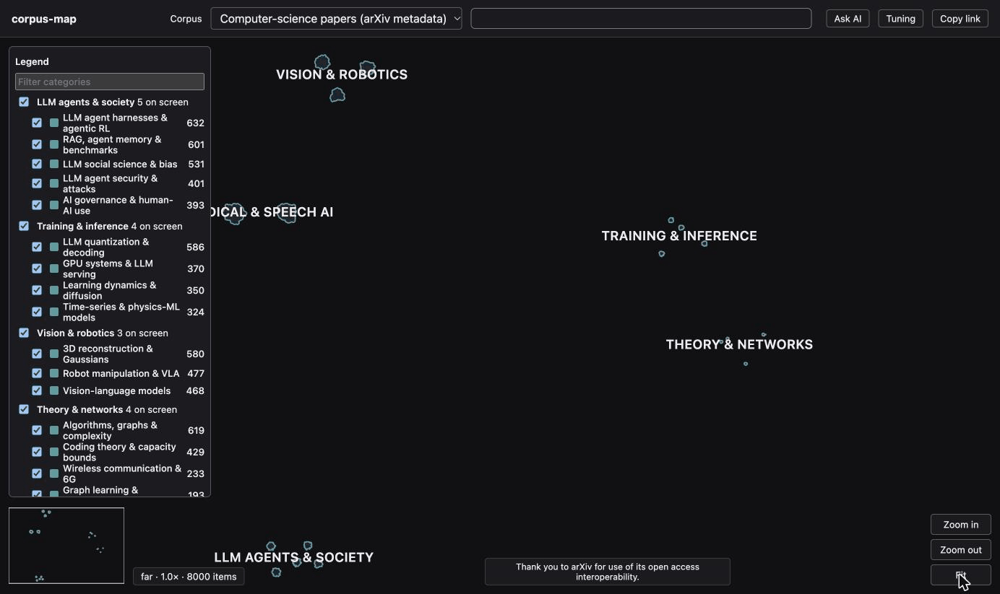
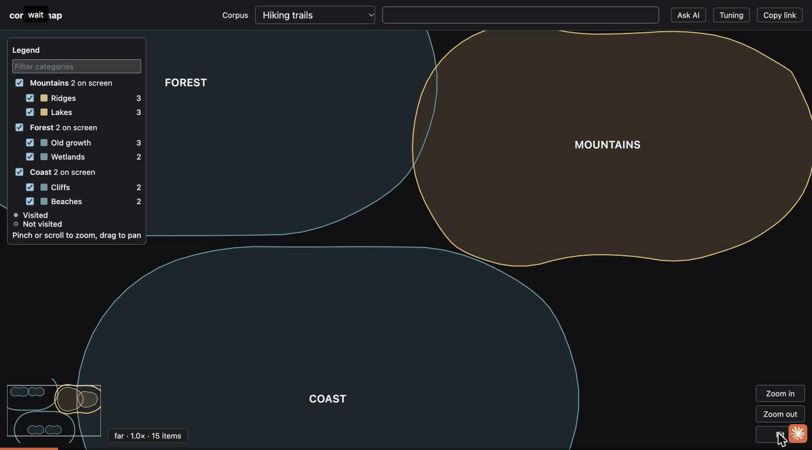

🇺🇸 [English](README.md) · 🇧🇷 [Português](README.pt.md)

[](https://github.com/albertosca/corpus-cartographer/actions/workflows/ci.yml)
[](https://github.com/albertosca/corpus-cartographer/actions/workflows/lint.yml)
[](https://github.com/albertosca/corpus-cartographer/actions/workflows/ci.yml)

# corpus-cartographer

**Give it items with tags (articles, notes, products, trails) and it finds which ones are related, says why, and lays them all out as a map you can browse.**

## Install

Download a binary for macOS (Apple silicon or Intel) or Linux x86_64 from the [latest release](https://github.com/albertosca/corpus-cartographer/releases/latest). To build from source you need Rust 1.88 or newer ([rustup](https://rustup.rs)):

```sh
git clone https://github.com/albertosca/corpus-cartographer
cd corpus-cartographer
cargo install --path .
```



On real data: 8,000 computer-science papers from arXiv, almost all from 2026, give 9,881 links in about two minutes, 8,351 of them explained by the words they share. The [arXiv example](docs/usage.md#a-real-corpus-8000-arxiv-papers) shows how to run it and where it falls short.

The [`corpus-map` live demo](https://albertosca.github.io/corpus-map/) shows the kind of map the output draws.

## Quick start

The input is one JSON file, the export: your **items**, the **terms** (tags or keywords) of each one, and the **themes** they sit in. This is one of the 15 items in `examples/hiking-trails.json`, trimmed to three terms:

```json
{
  "id": 101,
  "title": "Granite Spine",
  "subtheme_id": 11,
  "status": "assigned",
  "badges": [],
  "terms": [
    { "label": "granite", "term": "granite" },
    { "label": "ridge", "term": "ridge" },
    { "label": "summit", "term": "summit" }
  ]
}
```

Its themes are Mountains, Coast and Forest, each split into two subthemes. Run the engine on it from the clone, or fetch the file first if you only have the binary:

```sh
curl -fsSLO --create-dirs --output-dir examples https://raw.githubusercontent.com/albertosca/corpus-cartographer/main/examples/hiking-trails.json   # binary only
corpus-cartographer --input examples/hiking-trails.json --out-dir trails-map
```

It writes three files to `trails-map/` and prints a summary: 15 items, all placed in a theme, 14 with terms to compare (one has none), and 6 links.

```
items=15 placed=15 waiting=0 with_vector=14 links=6 warnings=0
```

Each link in `trails-map/links.json` says how alike two items are (cosine similarity, from -1 to 1) and which terms they share:

```json
{
  "source": 101,
  "target": 102,
  "similarity": 0.4894,
  "crosses_theme": false,
  "shared": [
    { "term": "ridge", "source_labels": ["ridge"], "target_labels": ["ridge"] },
    { "term": "summit", "source_labels": ["summit"], "target_labels": ["summit"] },
    { "term": "wind", "source_labels": ["wind"], "target_labels": ["wind"] }
  ]
}
```

The map itself is drawn by [`corpus-map`](https://github.com/albertosca/corpus-map#usage), a React component: give it `trails-map/map-spec.nested.json` as its `spec`. The [live demo](https://albertosca.github.io/corpus-map/) shows one without installing anything.



```
export.json ──▶ corpus-cartographer ──▶ links.json            links, positions, warnings
(+ embeddings,                       ├─▶ map-spec.v1.json      ──▶ corpus-map
   optional)                         └─▶ map-spec.nested.json  ──▶ corpus-map
```

## What you get

- **Explained links.** Each item's closest neighbours, and the terms each pair shares.
- **A map.** Themes, their subthemes and the items inside, placed in 2D. Items not yet sorted into a theme wait in a row below.
- **A map that keeps its shape.** Put the last run's positions in the export's `previous` field, and a new item does not spin or mirror the map.
- **Same input, same output.** There is no random seed, so two runs give the same bytes.
- **Fast, and one binary.** The 15-item example runs in under 10 ms, and 5,000 items with embeddings take about 10 s.
- **Your own terms.** Keywords, tags or entities you already have. Optional embeddings (word vectors) make related terms count as alike.
- **Plain JSON in and out.** Every file has a versioned JSON schema, so any language can write the input and read the output.

## Documentation

- [Usage](docs/usage.md): a complete minimal export, the options, embeddings, the output and the contract.
- [How it works](docs/how-it-works.md): why it exists, the design and its trade-offs, measured sizes, what the tests guarantee.
- [Contributing](CONTRIBUTING.md): the CI commands, where things live, changing the contract, releases.

## Works with

- [`corpus-map`](https://github.com/albertosca/corpus-map) draws the map specs.
- `corpus_atlas`, for Rails apps, builds the export from the app's database and saves the links back.

Any program that writes the JSON works just as well, and each piece also works alone.

## Status

Version 0.4.1, before 1.0. The input format can still change between minor versions, and each change is listed in the [CHANGELOG](CHANGELOG.md). The previous format keeps working for one more minor version.

## Licence

MIT.
