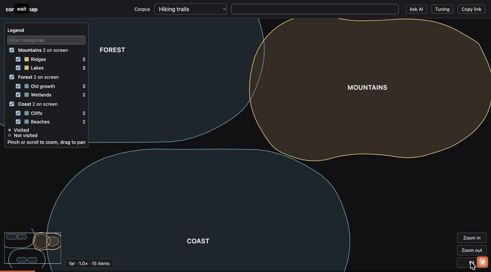

🇺🇸 [English](README.md) · 🇧🇷 [Português](README.pt.md)

[](https://github.com/albertosca/corpus-cartographer/actions/workflows/ci.yml)
[](https://github.com/albertosca/corpus-cartographer/actions/workflows/lint.yml)
[](https://github.com/albertosca/corpus-cartographer/actions/workflows/ci.yml)

# corpus-cartographer

**Dê a ele itens com tags (artigos, notas, produtos, trilhas) e ele descobre quais se relacionam, diz por quê e organiza tudo num mapa navegável.**

## Instalar

Baixe um binário para macOS (Apple silicon ou Intel) ou Linux x86_64 na [última release](https://github.com/albertosca/corpus-cartographer/releases/latest). Para compilar do código-fonte você precisa do Rust 1.88 ou mais novo ([rustup](https://rustup.rs)):

```sh
git clone https://github.com/albertosca/corpus-cartographer
cd corpus-cartographer
cargo install --path .
```



A [demo ao vivo do `corpus-map`](https://albertosca.github.io/corpus-map/) mostra o tipo de mapa que a saída desenha.

## Começo rápido

A entrada é um arquivo JSON, o export: os seus **itens**, os **termos** (tags ou palavras-chave) de cada um e os **temas** em que eles ficam. Este é um dos 15 itens de `examples/hiking-trails.json`, cortado para três termos:

```json
{
  "id": 101,
  "title": "Granite Spine",
  "subtheme_id": 11,
  "status": "assigned",
  "badges": [],
  "terms": [
    { "label": "granite", "term": "granite" },
    { "label": "ridge", "term": "ridge" },
    { "label": "summit", "term": "summit" }
  ]
}
```

Os temas dele são Mountains, Coast e Forest, cada um dividido em dois subtemas. Rode o motor nele a partir do clone, ou baixe o arquivo antes se você só tem o binário:

```sh
curl -fsSLO --create-dirs --output-dir examples https://raw.githubusercontent.com/albertosca/corpus-cartographer/main/examples/hiking-trails.json   # binary only
corpus-cartographer --input examples/hiking-trails.json --out-dir trails-map
```

Ele escreve três arquivos em `trails-map/` e imprime um resumo: 15 itens, todos posicionados num tema, 14 com termos para comparar (um não tem nenhum) e 6 ligações.

```
items=15 placed=15 waiting=0 with_vector=14 links=6 warnings=0
```

Cada ligação em `trails-map/links.json` diz o quanto dois itens se parecem (similaridade de cosseno, de -1 a 1) e quais termos eles compartilham:

```json
{
  "source": 101,
  "target": 102,
  "similarity": 0.4894,
  "crosses_theme": false,
  "shared": [
    { "term": "ridge", "source_labels": ["ridge"], "target_labels": ["ridge"] },
    { "term": "summit", "source_labels": ["summit"], "target_labels": ["summit"] },
    { "term": "wind", "source_labels": ["wind"], "target_labels": ["wind"] }
  ]
}
```

O mapa em si é desenhado pelo [`corpus-map`](https://github.com/albertosca/corpus-map#usage), um componente React: passe `trails-map/map-spec.nested.json` como o `spec` dele. A [demo ao vivo](https://albertosca.github.io/corpus-map/) mostra um mapa sem instalar nada.

```
export.json ──▶ corpus-cartographer ──▶ links.json            links, positions, warnings
(+ embeddings,                       ├─▶ map-spec.v1.json      ──▶ corpus-map
   optional)                         └─▶ map-spec.nested.json  ──▶ corpus-map
```

Com dados reais: 8.000 papers de computação do arXiv, quase todos de 2026, dão 9.881 ligações em uns dois minutos, 8.351 delas explicadas pelas palavras em comum. O [exemplo do arXiv](docs/usage.md#a-real-corpus-8000-arxiv-papers) mostra como rodar e onde ele fica devendo.

## O que você ganha

- **Ligações explicadas.** Os vizinhos mais próximos de cada item, e os termos que cada par compartilha.
- **Um mapa.** Temas, seus subtemas e os itens dentro deles, posicionados em 2D. Itens ainda sem tema esperam numa fileira abaixo.
- **Um mapa que mantém a forma.** Ponha as posições da última execução no campo `previous` do export, e um item novo não gira nem espelha o mapa.
- **Mesma entrada, mesma saída.** Não há semente aleatória, então duas execuções dão os mesmos bytes.
- **Rápido, e um binário só.** O exemplo de 15 itens roda em menos de 10 ms, e 5.000 itens com embeddings levam uns 10 s.
- **Os seus próprios termos.** Palavras-chave, tags ou entidades que você já tem. Embeddings opcionais (vetores de palavras) fazem termos relacionados contarem como parecidos.
- **JSON na entrada e na saída.** Cada arquivo tem um JSON schema versionado, então qualquer linguagem escreve a entrada e lê a saída.

## Documentação

A documentação detalhada está em inglês:

- [Uso](docs/usage.md): um export mínimo completo, as opções, embeddings, a saída e o contrato.
- [Como funciona](docs/how-it-works.md): por que existe, o design e as suas contrapartidas, tamanhos medidos, o que os testes garantem.
- [Contribuindo](CONTRIBUTING.md): os comandos do CI, onde fica cada coisa, mudar o contrato, releases.

## Funciona com

- O [`corpus-map`](https://github.com/albertosca/corpus-map) desenha os map specs.
- O `corpus_atlas`, para aplicações Rails, monta o export a partir do banco da aplicação e grava as ligações de volta.

Qualquer programa que escreva o JSON funciona igual, e cada peça também funciona sozinha.

## Status

Versão 0.4.1, antes da 1.0. O formato de entrada ainda pode mudar entre versões minor, e cada mudança é listada no [CHANGELOG](CHANGELOG.md). O formato anterior continua funcionando por mais uma versão minor.

## Licença

MIT.
